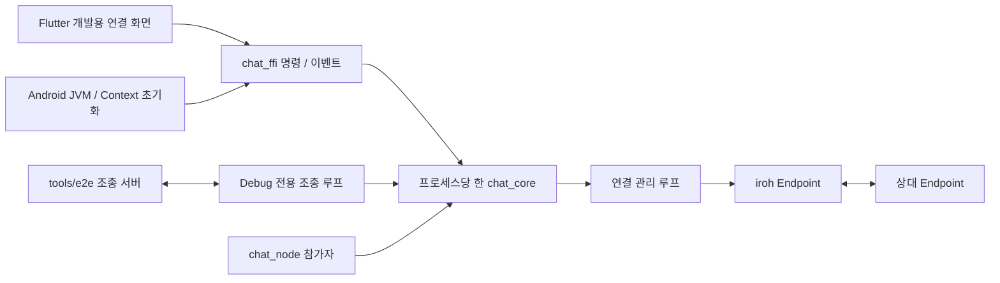

# M2 — iroh 연결과 여러 기기 시험 설계

상태: 사용자 승인, 2026-10-13(한국 시간). 세부 구현 계획 작성 단계이며 구현 코드는 아직 변경하지 않았다.

## 1. 목적과 완료 후 사용 모습

사용자가 Windows 앱, Android APK, iOS TestFlight 앱을 켜고 개발용 연결 화면에서 상대 주소를 붙여 넣으면 서로 글자를 주고받는다. 연결 경로가 직접 연결인지 릴레이인지 보이고, 네트워크가 끊겼다가 돌아오면 연결 상태를 다시 확인할 수 있다. 같은 Rust 코어를 화면 없는 참가자와 자동 시험에서도 사용한다.

기존 로드맵의 M2 목표와 승인된 자동 테스트 설계를 구체화한다. 승인된 실기기 범위는 세 플랫폼의 **전경 송수신**이다. iOS는 TestFlight 빌드가 필요하다.

포함: tokio 런타임, iroh 연결, 개발용 주소·송수신 화면, 연결 경로·오류 이벤트, 네트워크 복귀, 시험 조종 루프, 로컬 릴레이, CI와 Release 확인.

후속 단계: 계정·연락처·QR 초대(M3), DB·보내기 큐(M4), MLS(M5), 메일박스(M6), 실제 채팅 푸시(M7), 서버 큐(M8). M2는 오프라인 메시지를 저장하거나 재전송하지 않는다. 화면에 남은 시험 대화도 앱을 다시 켜면 사라진다.

## 2. 현재 상태와 선행 조건

- `chat_core`에는 시작 슬롯과 이벤트 버스만 있다. 네트워크·tokio는 아직 없다. 코어 시작, 같은 폴더의 중복 시작, 늦은 구독자의 연결 상태 재생 계약을 유지한다.
- `chat_ffi`의 FRB와 UniFFI가 같은 `CORE`를 쓰는 구조를 유지한다. Android Release 실행과 Debug 다리 시험은 완료했지만 Release Kotlin 호출 자체는 아직 검증하지 않았다.
- `tools/e2e`에는 기기 관리 도구만 있다. 조종 서버·참가자·시나리오는 새로 만든다.
- `spikes/a-connectivity`의 iroh 1.3 연결·경로 관찰을 참고한다. 스파이크의 Android 공용 DNS 우회는 앱에 복사하지 않는다.
- M1b 작업 트리에는 실측 문서 변경이 있고 병합은 아직 끝나지 않았다. M2 구현은 M1b 결과를 보존·통합한 기준에서 별도 작업 브랜치로 시작한다. 설계 작업이 미병합 문서를 지우거나 덮어쓰지 않는다.
- `Cargo.lock`의 `libc` 0.2.189 고정을 유지한다. 전체 `cargo update`로 해제하지 않는다. 기존 Rust 1.92.0, FRB 2.11.1, UniFFI 0.32.2를 유지한다.
- Apple 알림 필터링·multicast 신청은 사용자 결정대로 보류한다. M2에서 raw mDNS를 켜지 않으며 두 신청을 완료 조건으로 삼지 않는다.

근거 문서: [로드맵](../plans/2026-10-04-p2p-chat-roadmap.md), [전체 설계](2026-10-04-p2p-chat-design.md), [자동 테스트 설계](2026-10-05-test-automation-design.md), [M1a 인계](../plans/2026-10-05-m1a-carry-forward.md), [M1b 인계](../plans/2026-10-11-m1b-carry-forward.md).

## 3. 구조 선택

| 방식 | 장점 | 비용 |
|---|---|---|
| Rust의 한 관리 루프가 연결 상태와 작업 수명을 소유 — 선택 | 명령·연결 교체·종료 순서를 한 곳에서 정하고 기존 코어 공유 규칙을 유지한다 | 명령 채널과 작업 종료 관리가 필요하다 |
| FFI 명령마다 Endpoint 작업을 직접 생성하고 공유 상태를 잠근다 | 처음에는 명령을 바로 연결하기 쉽다 | 동시 연결·끊김 이벤트·작업 종료의 경쟁을 각 진입점에서 관리해야 한다 |

첫 번째 방식으로 설계한다. actor 프레임워크는 추가하지 않고 tokio 채널과 관리 루프를 쓴다. DNS와 QUIC의 구체 타입은 Rust 전송 모듈 안에 두고 Dart에는 문자열과 단순 이벤트만 전달한다.

`core_start`는 런타임을 준비하지만 외부망에 연결하지 않는다. 별도 `network_start`가 Endpoint를 만든다. 기존 시작 테스트가 공용 DNS·릴레이에 기대지 않게 한다. 화면과 조종 모드는 같은 명령·이벤트를 사용한다.

## 4. Endpoint, 주소, 보안 범위

- iroh와 iroh-relay는 1.3.0으로 맞춘다. `presets::Minimal`에 릴레이와 주소 조회를 명시적으로 붙인다. `N0` preset과 `dns.iroh.link` 조회는 쓰지 않는다.
- 앱의 공개망 경로는 `RelayMode::Default`와 Mainline DHT 주소 조회다. `iroh-mainline-address-lookup` 0.6.0의 게시 주소는 `AddrFilter::relay_only`로 제한해 공인·사설 IP를 DHT에 게시하지 않는다. 0.6.0 소스에서 DHT 게시가 기본으로 켜지고 HTTP relay 게시가 꺼지는 것을 확인했다. n0의 pkarr HTTP 게시 서비스를 따로 추가하지 않는다. crates.io 메타데이터의 iroh 요구 버전 `^1.0.0`은 1.3.0과 범위가 맞으며, 실제 통합 시 `cargo tree`로 iroh 중복 버전을 확인한다.
- 직접 전달하는 주소는 기존 스파이크와 같은 EndpointTicket이다. UI는 EndpointId와 티켓을 보여 준다. 상대 입력은 티켓 또는 EndpointId를 받으며 EndpointId만 입력한 경우 DHT 조회 결과를 사용한다. 티켓에는 상대와 직접 교환한 주소가 들어갈 수 있으므로 공유 범위를 화면에 설명한다.
- TransportKey는 M2에서 프로세스 동안만 유지한다. 앱 프로세스를 다시 시작하면 EndpointId가 달라진다. 예전 주소로 새 프로세스를 자동으로 찾는 기능은 M3의 기기 키·게시 기록과 함께 구현한다.
- iroh의 전송은 암호화되고 EndpointId로 상대 키를 확인한다. **MLS나 연락처의 신원 확인은 아직 없다.** 이번 개발 화면을 제품의 종단간 암호화 채팅으로 표현하지 않는다.
- iOS에서는 `fast-apple-datapath`를 끈다. iroh는 `default-features = false`, `features = ["tls-ring"]`으로 시작한다. workspace feature 합성으로 다른 경로에서 기본 기능이 다시 켜지지 않는지도 검사한다. raw mDNS·새 Apple entitlement·푸시 확장은 M2에 추가하지 않는다.

[iroh 문서](https://docs.rs/iroh/latest/iroh/)는 확인 시 1.3.0이다. [Mainline 조회 crate](https://docs.rs/iroh-mainline-address-lookup/latest/iroh_mainline_address_lookup/)와 [의존성 메타데이터](https://crates.io/api/v1/crates/iroh-mainline-address-lookup/0.6.0/dependencies)를 확인했다. 이 버전 정보가 바뀌어도 위에 정한 버전을 자동으로 올리지 않는다.

## 5. 명령과 이벤트 계약

기존 `core_start`, `core_version`, `events` 계약을 유지한다. 전송 명령은 비동기로 처리하며 Dart 화면 스레드나 코어 슬롯의 잠금을 잡은 상태에서 네트워크를 기다리지 않는다.

| 명령 | 입력 | 결과 / 동작 |
|---|---|---|
| `network_start` | 없음 | 공개망 Endpoint를 시작하고 `NetworkInfo` 반환. 이미 시작했다면 기존 설정·인스턴스 반환 |
| `network_info` | 없음 | 상태, 선택적 EndpointId·티켓, 연결된 `PeerInfo` 목록 |
| `connect_peer` | `target: String` | 검증된 티켓/EndpointId로 연결, `PeerInfo` 반환 |
| `send_probe_text` | `peer_id: String`, `text: String` | 연결된 상대의 쓰기 작업 결과. 상대 앱의 처리·저장 완료를 뜻하지 않음 |
| `disconnect_peer` | `peer_id: String` | 해당 연결과 자동 재연결 의도를 종료 |
| `network_stop` | 없음 | 진행 중 작업을 취소하고 Endpoint 종료. 코어 인스턴스는 유지 |

`NetworkInfo.state`: `Stopped`, `Starting`, `Online`, `Failed`. `PeerInfo`: EndpointId, `Connecting`/`Connected`/`Reconnecting`/`Disconnected`, `Unknown`/`Relay`/`Direct` 경로. `Online`은 상대 연결 완료를 뜻하지 않는다.

실측을 위해 `PeerInfo`에 선택적 `connect_ms`·`direct_ms`를 둔다. 연결 명령을 받은 로컬 monotonic 시작점부터 스트림 준비 완료와 최초 Direct 관찰까지의 시간이다. 상대의 시계와 비교하지 않으며, 수동으로 시작하지 않은 수신 연결에는 값이 없을 수 있다.

새 이벤트는 `NetworkChanged`, `PeerChanged`, `ProbeTextReceived`다. 기존 `ConnectionState.direct_peers`는 현재 선택된 직접 경로를 가진 연결의 **상대 수**다. 릴레이 연결을 세지 않고 한 상대의 복수 연결도 중복 계산하지 않는다. 경로는 iroh 1.3의 `paths`·`path_events`로 관찰한다. 이벤트를 놓쳤다는 경로 알림을 받으면 현재 경로를 다시 읽는다.

기존 연결 상태 재생은 유지한다. 메시지는 늦은 구독자에게 재생하지 않는다. 화면은 구독한 뒤 `network_info`를 읽고 이후 상태 이벤트를 적용한다. 이 둘의 경쟁을 막도록 상태 스냅숏과 상태 이벤트에는 같은 관리 루프가 증가시키는 `revision: u64`를 둔다. 화면은 이미 적용한 revision보다 오래된 스냅숏을 버린다. 수신 문자열은 Rust에서 UTF-8과 길이를 확인한 뒤 이벤트로 보낸다.

추가 오류: `CoreNotStarted`, `NetworkNotStarted`, `InvalidPeerAddress`, `SelfConnection`, `PeerNotConnected`, `MessageTooLarge`, `Busy`, `NetworkTimeout`, `TransportFailed`, `NotAvailable`. 각 갈래를 Rust→FRB 변환과 화면 테스트로 고정한다. 주소·키·메시지 본문 전체를 일반 오류 로그에 붙이지 않는다.

`send_probe_text`는 M2 시험용 의미다. 기존 전체 설계의 `send_text(conversation_id, body)`와 저장·메시지 상태 계약을 미리 흉내 내지 않는다. M3·M4가 대화 식별자를 도입할 때 후자의 명령을 추가한다.

## 6. 전송, 경쟁 상태, 중단

- ALPN은 `chatproject/m2/1`. 연결마다 각 방향에 순서가 유지되는 QUIC 단방향 스트림을 하나씩 연다. 양쪽은 스트림 시작에 `CPM2` 4바이트를 써 상대의 스트림 수락이 실제로 진행되게 한다. 잘못된 시작 바이트나 추가 데이터 스트림은 프로토콜 오류다.
- 프레임은 `u32` big-endian 바이트 길이와 UTF-8 본문이다. 본문은 1–4096바이트, 빈 문자열은 거부한다. 길이를 읽은 뒤 상한을 확인하고 할당한다. 프레임 중간 EOF·잘못된 UTF-8·초과 길이는 해당 세션을 종료하고 이벤트를 남긴다.
- 한 방향의 쓰기는 한 작업에서 순서대로 수행한다. QUIC stream write 성공을 상대 화면 표시나 메시지 보관 완료로 표현하지 않는다. 애플리케이션 ACK·메시지 보장·재전송은 M4 이후다. [iroh 연결 문서](https://docs.rs/iroh/latest/iroh/endpoint/struct.Connection.html)의 close/write 의미를 따른다.
- M2의 제한은 연결 상대 8개, 대기 명령 64개, 상대별 대기 쓰기 16개다. 포화 시 `Busy`로 거부한다. UI는 최근 시험 메시지 200개만 메모리에 둔다. 무제한 채널이나 무제한 수신 버퍼는 쓰지 않는다.
- 같은 상대에 동시에 양쪽이 연결하면 EndpointId가 작은 쪽이 시작한 연결을 우선한다. 기존의 유효한 단일 연결은 경쟁 연결이 없으면 유지한다. 연결 교체마다 generation을 붙여 이전 연결의 종료·경로 이벤트가 새 연결을 지우지 못하게 한다.
- 연결·스트림 준비 시간 한도는 10초, 쓰기 시간 한도는 5초다. 중단 명령은 진행 중 작업을 취소한다. 네트워크 복귀 후 같은 프로세스의 상대에 재연결할 때 1·2·4초 뒤 시도하고 이후 간격은 8초로 제한한다. 재시도 시작 후 30초가 지나면 진행 중 시도도 취소하고 끊김 상태에서 수동 재시도를 기다린다. QUIC의 keep-alive·경로 생존 감지는 iroh 1.3 기본 설정을 사용하며 별도 애플리케이션 heartbeat는 넣지 않는다.
- Wi-Fi↔LTE 전환은 먼저 iroh의 경로 이동을 관찰한다. 세션이 종료되면 알려진 상대 주소로 위 재연결을 수행한다. 오프라인 중 입력은 `PeerNotConnected`로 거부하고, 이미 실패한 글자를 복귀 후 자동으로 다시 보내지 않는다.
- `network_stop`은 수락·읽기·쓰기·경로·재연결 작업을 추적해 종료하고 Endpoint를 닫는다. actor가 느린 연결이나 수신 작업을 직접 기다려 다른 명령 처리를 막지 않게 한다. Tokio 런타임 종료가 Tokio 작업 안에서 blocking drop을 일으키지 않게 한다.

## 7. 화면과 플랫폼 연결

개발용 화면에는 내 EndpointId/티켓 복사, 상대 주소 입력, 연결·해제, 연결 상대와 경로, 글자 입력·전송, 수신 목록, 오류 표시를 둔다. 기존 빈 대화 화면에서 이 화면으로 들어간다. Windows는 넓은 창, Android·iOS는 좁은 화면에서도 같은 기능을 제공한다. 전체 UI 목업의 연락처·그룹·온보딩은 구현하지 않는다.

Android:

1. 주 매니페스트에 `INTERNET` 권한을 넣는다.
2. `MainActivity.onCreate`에서 `super.onCreate`로 Flutter 초기화가 시작되기 전에 `System.loadLibrary("chat_ffi")`와 아래 Context 초기화를 수행한다.
3. `JNI_OnLoad`는 JVM과 JNI 버전을 준비한다. 별도 JNI 초기화 함수가 실제 `applicationContext`를 받아 GlobalRef로 보관하고 `install_android_jni_context`를 **Endpoint 생성 전에** 호출한다. 초기화는 같은 프로세스에서 한 번만 수행한다.
4. `JNI_OnLoad`의 `reserved`를 Context로 쓰지 않는다. [JNI 명세](https://docs.oracle.com/en/java/javase/26/docs/specs/jni/invocation.html)는 이 인자를 unused로 정의하고, 로컬 iroh-dns 1.3.0은 JVM·Context 포인터가 프로세스 동안 유효해야 한다고 명시한다. 기존 로드맵의 'JNI_OnLoad에서 DNS 초기화' 설명을 이 순서로 수정한다.
5. 시험 채널 `chat_app/native_core`와 조종 인텐트는 Debug에서만 등록한다. 기존 Kotlin 다리 검증은 Debug 계약으로 유지한다. Release의 JNI/DNS 초기화는 실제 Release 네트워크 시작·릴레이 호스트 조회·송수신으로 확인한다. 향후 JNA/UniFFI 기반 푸시 진입점의 Release 호출 시험은 M7 진입 조건으로 계속 남긴다.

iOS: 전경에서만 시험한다. LAN 접속 설명 `NSLocalNetworkUsageDescription`을 준비하고 사용자 거부를 오류·상태로 처리한다. `NSBonjourServices`는 실제 Bonjour 검색을 추가할 때 넣는다. raw mDNS는 사용하지 않으며 백그라운드 수신을 약속하지 않는다. TestFlight 서명·업로드는 기존 파이프라인을 사용한다.

Windows: `--data-dir`로 시험 인스턴스마다 다른 폴더를 지정한다. 일반 사용자 주소·메시지는 M2에서 파일에 저장하지 않는다. 같은 폴더를 여러 프로세스가 여는 독점 잠금은 M4의 DB·영구 키 저장 전으로 미룬다. 시작 실패와 이벤트 스트림 실패는 화면과 진단 기록 모두에 나타나야 한다.

## 8. 여러 기기 시험 장치

- `chat_core/test-hooks`와 같은 이름의 `chat_ffi` feature로 조종 루프를 제한한다. cargokit의 Debug `extra_flags`에서만 켠다. Release·Profile에서는 꺼진다.
- `test_hooks_start(control_url, name)` FRB 함수는 항상 생성하되 feature가 꺼졌으면 `NotAvailable`. Debug 실행 인자 처리는 `kDebugMode` 안에 둔다. `chat-test-hooks:v1` 표식은 조종 코드 안에만 둔다.
- `tools/e2e`가 루프백 WebSocket 서버를 열고 `hello/cmd/result/event`를 사용한다. RPC ID는 요청당 고유하며 응답을 그 ID와 맞춘다. 참가자가 끊기면 미완료 요청을 즉시 실패 처리한다. 재시작은 같은 참가자 이름과 새 코어 인스턴스로 구분한다. `event.seq`는 코어 인스턴스별로 증가하며 누락·중복·역순이면 시험을 실패 처리한다.
- 조종 명령은 위 코어 명령과 같은 이름·인자를 쓴다. M2에서 `clock_advance`나 초대·DB 명령은 구현하지 않는다. `set_offline`만 시험용으로 넣고, false일 때 동일 프로세스의 키로 Endpoint를 다시 만든다.
- `chat_node`는 `puppet` 참가자와 `relay` 하위 명령을 제공한다. 릴레이는 iroh-relay 1.3.0 서버를 `127.0.0.1:3340`, TLS 없음으로 띄운다. 조종 서버는 `127.0.0.1:47000`이다. 포트가 이미 쓰이면 실패하며 기존 프로세스를 종료하지 않는다.
- Android는 두 포트에 `adb reverse`를 사용한다. 모든 자동 시험 참가자는 시작 전에 격리 설정을 받는다. 로컬 릴레이만 사용하고 DHT·공용 DNS·n0 릴레이를 켜지 않는다. 공개망 Endpoint를 먼저 띄웠다가 시험 설정으로 바꾸는 초기화 순서는 금지한다.
- Debug 조종 참가자의 네트워크 시작은 먼저 격리 설정으로 이루어진다. 이후 UI가 `network_start`를 호출해도 기존 설정을 반환한다. 사용자 Release 화면에는 릴레이 설정이나 조종 서버 입력을 노출하지 않는다.
- 도구는 자신이 시작한 프로세스·AVD·포트 역방향 연결만 정리한다. 이미 켜져 있던 사용자 AVD는 유지한다. 일반 실패와 처리 가능한 Ctrl+C에는 같은 정리 루프를 수행하고 최초 실패 종료 코드를 보존한다. 강제 호스트 종료로 정리하지 못한 경우 소유 기록을 남긴다.
- 실패 시 `build/e2e/<실행 시각>/<시나리오>/`에 명령 순서, 참가자 이벤트, 참가자 프로세스 출력과 해당 앱의 logcat을 남긴다. 공개 git 이력에는 토큰·시리얼·실제 IP·티켓·개인 경로를 넣지 않는다.

## 9. 검증과 완료 기준

| 검증 층 | 완료 기준 |
|---|---|
| Rust / 로컬 Endpoint | 직접 주소로 두 Endpoint를 연결해 양방향 UTF-8을 주고받는다. DHT·공용 릴레이 없이 실행된다 |
| 프로토콜·수명 | 경계 길이, 잘못된 UTF-8, 중간 EOF, 대기 포화, 자기 연결, 잘못된 티켓, 잘못된 ALPN, 동시에 양쪽 연결, 교체된 세션의 늦은 이벤트, 중단 중 작업 종료를 고정한다 |
| 이벤트·다리·화면 | 모든 새 enum 변환, 늦은 상태 구독, 닫힌 Dart 스트림 제거, 오류 표시, 스트림 실패, 초기화 실패, 송신 실패 후 자동 재전송 없음 |
| 로컬 혼합 E2E | Windows 앱·Android 에뮬레이터·chat_node 3종을 한 번의 명령으로 실행한다. 각 조합의 양방향 송수신과 끊김·복귀를 확인한다 |
| 플랫폼별 야간 E2E | Linux는 Android 에뮬레이터 2대·headless, Windows 러너는 Windows 앱 2개·headless. Linux 러너에서 Windows 실행 파일을 실행하려 하지 않는다 |
| Release | Android ARM64 APK와 Windows 산출물을 실제 실행한다. Rust 라이브러리와 포함 네이티브 산출물에서 조종 표식이 없고 Release의 `test_hooks_start`는 `NotAvailable`다. Android Release에는 필요한 INTERNET·JNI 초기화가 있고 시험 채널은 없다 |
| iOS | 기존 Simulator와 unsigned Release CI가 통과한다. TestFlight에서 Windows↔iPhone 전경 송수신·오류 표시를 확인한다 |
| 실제 망 | Windows 가정 회선↔Android KT LTE에서 첫 연결·직접 전환 시간을 각각 로컬 monotonic clock으로 측정한다. 기존 목표는 0.5초·1초다. 10회 표본과 경로를 기록하고, 목표 미달은 원인·사용자 판단 없이 통과 처리하지 않는다 |
| 전환·복귀 | 실제 폰 Wi-Fi↔LTE, 자동 시험의 상대 중단·네트워크 복귀 뒤 다시 연결해 **새로 보낸 글자**가 도착한다. 프로세스 재시작으로 EndpointId가 바뀌면 새 주소를 입력한다 |

CI의 단위·위젯·플랫폼 통합·표식 검사·Release 스모크는 매 push/PR에 수행한다. E2E는 매일 밤과 수동 실행이다. 공개 저장소의 기본 트리거 허용 목록은 유지하면서 새 `e2e.yml`에만 `schedule`을 허용하는 규칙을 추가한다. 권한은 `contents: read`, 액션은 SHA 고정, checkout 자격 증명은 저장하지 않는다. 야간 시험에는 TestFlight·Firebase 비밀값을 넣지 않는다.

Release 실행 시험과 Debug 자동 테스트 결과를 구분해 기록한다. ARM64는 실제 폰으로 확인한다. 현재 실제 폰은 64비트 전용이므로 ARMv7을 실행 검증했다고 표시하지 않는다. ARMv7 빌드는 유지하고 실행 검증은 해당 기기를 확보한 배포 전 단계로 이관한다(2026-10-13 승인).

## 10. 변경할 파일의 책임

| 위치 | 책임 |
|---|---|
| `core/chat_core/src/runtime.rs`, `event.rs`, `error.rs` | 기존 시작 계약, 네트워크 소유자·이벤트·오류 연결 |
| `core/chat_core/src/transport/` | Endpoint 설정, 세션, 프레임, 경로·연결 수명 |
| `core/chat_core/src/puppet/` | feature로 제한한 WebSocket 조종 루프 |
| `core/chat_core/tests/` | 실제 로컬 Endpoint·릴레이와 수명 테스트 |
| `app/rust/src/api/chat.rs`, `convert.rs`, 새 Android JNI 모듈 | 얇은 FRB 계약, exhaustive 변환, JVM·Context 초기화 |
| `app/rust/cargokit.yaml`, 관련 Cargo manifest | Debug feature·고정 의존성 연결 |
| `app/lib/core_client.dart`, `main.dart`, 개발용 연결 화면·테스트 | 인자 파싱, 상태·오류·시험 송수신 UI |
| Android `MainActivity`, 주 매니페스트, iOS `Info.plist` | 플랫폼 로더·권한·전경 접속 설명 |
| `tools/chat_node/`, `tools/e2e/` | headless/relay, 조종 서버·참가자·시나리오·정리 |
| `.github/workflows/`, `tools/ci/`, `tools/gen_bindings.sh` | 새 통합 테스트 실행, Release·표식 검사, 야간 트리거와 필요한 고정 도구 |

생성된 FRB·UniFFI 코드는 생성 명령으로만 갱신한다. 상세 파일명·함수 시그니처·실패 먼저/성공 후 단계는 이 설계 검토 후 구현 계획에서 고정한다.

## 11. 인계 항목 처리와 실행 전 확인

| 인계 항목 | M2 처리 |
|---|---|
| M1a M2 #1–4 | Android 인터넷·JNI 초기화, 시험 채널 Debug 제한, Release CI 스모크에 포함 |
| #5 | ARM64 실기기 확인. ARMv7 실행은 장비 제약을 명시해 배포 전으로 이관 |
| #6–9, #12–14 | 이벤트 싱크는 nonblocking·재진입 금지 계약, 실패를 조용히 버리지 않도록 시험. 새 변환과 전역 코어 시험, 시작·스트림 오류 기록에 포함 |
| #10 | 이번에 손대는 파일부터 기존 스타일에 맞춘 형식 검증. 저장소 전체 형식 변경은 별도 정리로 이관 |
| #11 | M2에는 영구 키·DB를 쓰지 않음. 독점 폴더 잠금은 M4 시작 전에 수행. 시험 인스턴스는 별도 폴더 |
| #15–25 | 여러 기기 도구에 필요한 인자 전달, 스냅숏·이미지 검증, 외부 명령 결과, 소유권·실패 정리·취소·진단 테스트에 포함. 전역 `adb kill-server`는 자동 실행하지 않음 |
| #26–28 | CI AVD 설정·캐시 기준, Windows 새 통합 테스트 실행, 두 AVD 작업의 Gradle 메모리 점검에 포함 |
| M1b M2 #1–5 | 야간 트리거의 좁은 예외를 포함한 허용 목록, 작업 권한·재사용 workflow·로컬 액션, 기본 검사와 파일 탐색·입력 오류 테스트 |
| #6–7 | 바인딩 도구의 cargo-expand 고정, pub get 전제 명시. 새 enum·JNI 바인딩 생성에 필요한 항목 |
| #8–9 | 생성 스크립트 버전 판정·경로·실패 diff와 Simulator 선택 테스트. Darwin 생성 스크립트는 macOS 검증에 한 번 포함. upstream yanked 경고 제거를 위한 의존성 일괄 갱신은 하지 않음 |
| #10–11 | cargokit 빈 툴체인 오류, Windows·iOS 로그의 실제 Rust 1.92.0 빌드 확인 |

실행 전에 M1b 문서·검증 결과의 통합 기준을 확인한다. iOS TestFlight 전경 시험, ARMv7 실행 이관, 야간 workflow의 좁은 예약 실행 예외와 JNI 초기화 설명 수정은 2026-10-13 설계 승인에 포함됐다.

구현 순서는 플랫폼 선행 조건과 코어 수명 → 로컬 송수신·경로 → FRB·화면 → 조종 루프·headless → 기기 도구·E2E → CI·Release·실기기 확인이다. 각 단위는 독립된 실패 재현·성공 검증을 가져야 한다. 설계 검토 후 해당 순서의 구현 계획을 작성한다.
